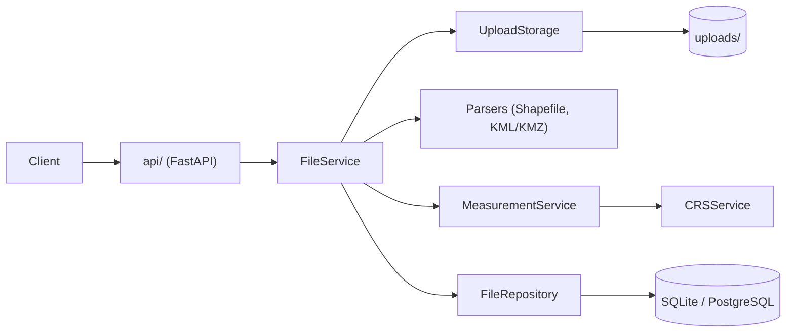
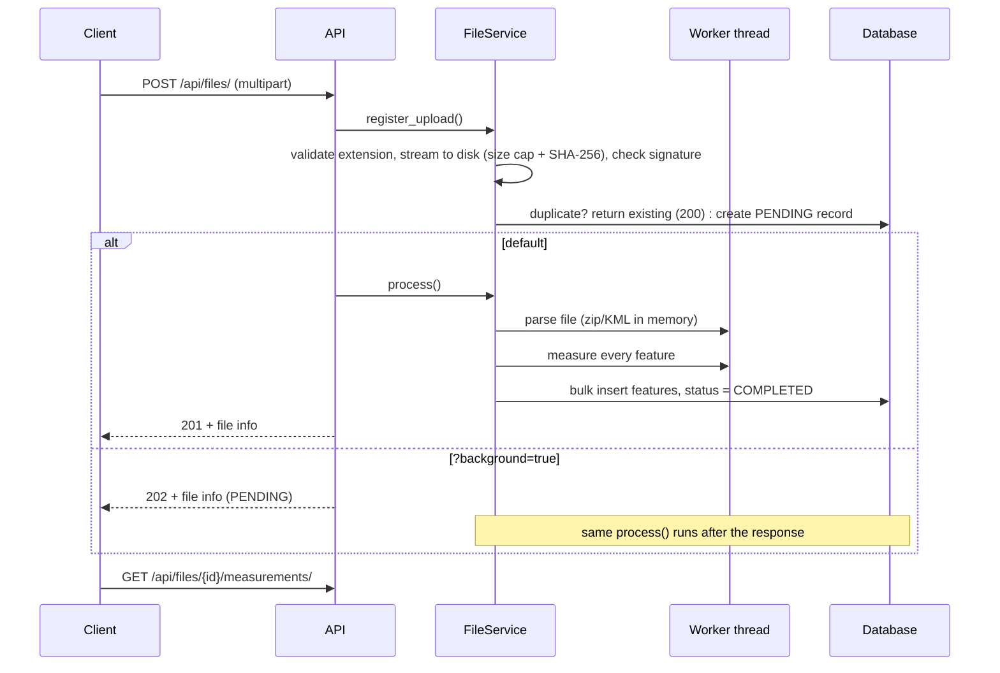

# Geospatial File Measurement API

A FastAPI backend that accepts a **Shapefile (`.zip`)**, **KML** or **KMZ**, extracts every feature and returns
**area** (polygons) and **length** (lines) in metres.

The part that is easy to get wrong in geospatial code is the coordinate system, so that is where most of the
engineering went: measurements are **never** taken in lat/lon degrees, and they are also not blindly taken in whatever
projected CRS the file happens to use (see [CRS handling](#crs-handling)). Every planar number is cross-checked against
a geodesic calculation on the WGS-84 ellipsoid and the difference is reported.

**What you get**

- The three required endpoints (`POST /api/files/`, `GET /api/files/{id}/`, `GET /api/files/{id}/measurements/`) plus
  list, streamed GeoJSON/CSV export and delete.
- A local metric projection chosen per feature (UTM, UPS near the poles), with a geodesic ground-truth check.
- Bad features never fail a file: each feature carries its own `status` and `notes`.
- Safe by default: size limits, zip-bomb and XXE protection, no path traversal, CSV-injection-safe export.
- Large files can be processed in the background (`?background=true`) and polled.
- 189 automated tests (97 % line coverage), lint/format checks and CI.
- A small map dashboard at `/` for trying it out.
- A short note on [how this lines up with Aereo Cloud](#how-this-maps-to-aereo-cloud) and what I would build next.

---

## How this maps to Aereo Cloud

The brief is the assignment; this section is how its pieces line up with what Aereo has said publicly about
**Aereo Cloud** (drone data in, 2D/3D maps, measurements and analytics out). It uses public sources only (listed at
the end); I have no inside knowledge of Aereo's stack, so the right-hand column is my reading, not a claim about
your system.

| What Aereo says publicly | Where this repo already helps |
| ------------------------ | ----------------------------- |
| Aereo Cloud imports **SHP, KML**, TIFF, MBTiles and CSV and works with multiple coordinate systems | Shapefile (`.zip`), KML and KMZ parsers behind a registry (`app/services/parsers/`). The CRS is read from the `.prj` and never silently assumed. A new format is one class. |
| Markets in India, the Gulf (partnership with [Seed Group](https://seedgroup.com/news/seed-group-partners-with-indian-commercial-drone-innovator-aereo-to-elevate-smart-city-initiatives-across-mena/)) and global mining (partnership with [Datamine](https://im-mining.com/?p=112195)) | The metric CRS follows the feature: UTM zone per feature, checked against the ellipsoid for India, UAE, South Africa, Australia, Chile and the Norway zone exception (`tests/test_api.py::TestGlobalCoverage`). |
| A **Measure** module (cut-fill and stockpile volumes from surface models), with accuracy as a selling point | Area and length in metres, each cross-checked against a geodesic value with the difference reported per feature, so a poor projection is visible instead of hidden. |
| Large survey archives (Aereo's own figures: 3,750+ mine surveys) and a **Share** module | Paginated results, streamed GeoJSON/CSV export, background processing, SHA-256 de-duplication. |
| Enterprise customers and a role that mentions production systems and authentication | One error shape, request ids, `/health`, limits for hostile files, CI and tests. Authentication is a documented gap under [Known limitations](#known-limitations). |

**Sources:** [Aereo Cloud for mining](https://resources.aereo.io/) (import formats, measurement features) ·
[JSW Ventures on Aereo](https://www.jswvc.com/aereo) (customers, software-led strategy) ·
[Series B coverage](https://www.geospatialworld.net/news/aereo-secures-15-million-in-series-b-funding-round/)
(customers and programmes) · [Datamine partnership, Oct 2025](https://im-mining.com/?p=112195) ·
[Seed Group partnership](https://seedgroup.com/news/seed-group-partners-with-indian-commercial-drone-innovator-aereo-to-elevate-smart-city-initiatives-across-mena/).

---

## Setup

Requires **Python 3.11+** (developed and tested on 3.12). No system libraries are needed: Shapely and PyProj ship
wheels that bundle GEOS and PROJ.

### Run locally

```bash
python -m venv .venv
source .venv/bin/activate          # Windows: .venv\Scripts\activate
pip install -r requirements-dev.txt

uvicorn app.main:app --reload
```

| URL                            | What                                   |
| ------------------------------ | -------------------------------------- |
| http://localhost:8000/         | Map dashboard (upload + visualise)     |
| http://localhost:8000/docs     | Swagger UI (try every endpoint)        |
| http://localhost:8000/redoc    | ReDoc                                  |
| http://localhost:8000/health   | Liveness + database check              |

Try it with the bundled samples:

```bash
curl -F "file=@sample_data/survey_sample.kml" http://localhost:8000/api/files/
# -> {"id": "492eb6d0...", "status": "COMPLETED", "feature_count": 4, ...}

curl http://localhost:8000/api/files/<id>/measurements/
```

`sample_data/` contains a KML (polygon, line, point, polygon-with-hole), a Shapefile in EPSG:4326 and a Shapefile in
EPSG:32643 (UTM 43N, metres).

### Docker

```bash
docker compose up --build          # http://localhost:8000
```

The image runs as a non-root user; the SQLite database and uploads live in named volumes.

### Tests and checks

```bash
pytest --cov=app --cov-report=term-missing
ruff check . && ruff format --check .
```

### Configuration

All settings are environment variables (or a `.env` file, see `.env.example`).

| Variable                  | Default                     | Meaning                                                        |
| ------------------------- | --------------------------- | -------------------------------------------------------------- |
| `DATABASE_URL`            | SQLite in `data_store/`     | Any SQLAlchemy async URL                                       |
| `MAX_UPLOAD_SIZE_MB`      | `50`                        | Upload size limit (HTTP 413 above it)                          |
| `MAX_UNCOMPRESSED_SIZE_MB`| `250`                       | Zip-bomb guard for archives                                    |
| `MAX_ZIP_ENTRIES`         | `500`                       | Zip-bomb guard for archives                                    |
| `MAX_FEATURES`            | `250000`                    | Features per file                                              |
| `DEDUPLICATE_UPLOADS`     | `true`                      | Return the existing record for byte-identical uploads          |
| `KEEP_UPLOADED_FILES`     | `true`                      | Keep the original upload after processing                      |
| `DISTORTION_WARNING_PCT`  | `0.5`                       | Planar-vs-geodesic gap that triggers a warning note            |
| `CORS_ORIGINS`            | `["*"]`                     | JSON list; restrict this in production                         |
| `LOG_LEVEL`               | `INFO`                      |                                                                |

---

## API

| Method   | Path                              | Purpose                                                   |
| -------- | --------------------------------- | --------------------------------------------------------- |
| `POST`   | `/api/files/`                     | Upload and process a file                                 |
| `GET`    | `/api/files/{id}/`                | File info and processing status                           |
| `GET`    | `/api/files/{id}/measurements/`   | Per-feature measurements + file summary                   |
| `GET`    | `/api/files/{id}/export`          | Download results as GeoJSON or CSV (streamed)             |
| `GET`    | `/api/files/`                     | List files (`limit`, `offset`, `X-Total-Count` header)    |
| `DELETE` | `/api/files/{id}/`                | Delete the record, its features and the stored upload     |
| `GET`    | `/health`                         | Liveness + database check (503 if the DB is down)         |

### Upload: `POST /api/files/`

`multipart/form-data` with a `file` field: a `.zip` containing a Shapefile, a `.kml`, or a `.kmz`.

```bash
curl -F "file=@survey.kml" http://localhost:8000/api/files/
```

```json
{
  "id": "5c1e0a77b8f94d0e9d3a4b2f6a8c1d20",
  "filename": "survey.kml",
  "feature_count": 4,
  "crs": "EPSG:4326",
  "status": "COMPLETED",
  "progress_pct": 100,
  "file_type": "KML",
  "file_size_bytes": 2734,
  "file_hash_sha256": "e94bf49d...",
  "error_message": null,
  "warnings": [],
  "uploaded_at": "2026-10-08T21:18:02.158849Z"
}
```

| Status | When                                                                                          |
| ------ | --------------------------------------------------------------------------------------------- |
| `201`  | Processed. `Location` header points at the new resource.                                      |
| `200`  | An identical file (same SHA-256) was already processed; the existing record is returned.       |
| `202`  | `?background=true`: accepted; poll `GET /api/files/{id}/` until `status` is `COMPLETED`.      |

`status` moves `PENDING → PROCESSING → COMPLETED` (or `FAILED` with an `error_message`). `warnings` holds non-fatal
findings, for example *"no .prj; coordinates look like lon/lat so EPSG:4326 was assumed"*.

### Measurements: `GET /api/files/{id}/measurements/`

Query parameters: `geometry_type` (e.g. `Polygon`), `status` (e.g. `INVALID_COORDINATES`), `limit` (1-1000, default
100), `offset`. The `summary` always covers the whole file; `features` honours filters and pagination.

```json
{
  "id": "5c1e0a77b8f94d0e9d3a4b2f6a8c1d20",
  "filename": "survey.kml",
  "crs": "EPSG:4326",
  "summary": {
    "total_features": 4, "polygon_count": 2, "linestring_count": 1, "point_count": 1,
    "unsupported_count": 0, "failed_count": 0,
    "total_area_sq_meters": 3472966.96, "total_area_hectares": 347.2967,
    "total_length_meters": 3106.39, "total_length_kilometers": 3.1064,
    "average_polygon_area_sq_m": 1736483.48, "average_linestring_length_m": 3106.39
  },
  "features": [
    {
      "feature_id": "0",
      "index": 0,
      "geometry_type": "Polygon",
      "geometry": { "type": "Polygon", "coordinates": ["..."] },
      "geometry_wgs84": null,
      "crs": "EPSG:4326",
      "projected_crs": "EPSG:32643",
      "properties": { "name": "Solar Plant Sector A", "Project": "Aereo CleanEnergy Phase 1" },
      "measurement": {
        "measurement_type": "area",
        "value": 1201674.84,
        "unit": "square_meters",
        "formatted": "1,201,674.84 m² (120.1675 ha | 1.2017 km²)",
        "alternative_units": { "hectares": 120.1675, "square_kilometers": 1.201675, "acres": 296.9403 },
        "advanced_metrics": {
          "geodesic_value": 1200289.84,
          "distortion_percentage": 0.1154,
          "perimeter_meters": 4385.05,
          "vertex_count": 5
        }
      },
      "status": "SUCCESS",
      "notes": []
    }
  ],
  "total_count": 4, "limit": 100, "offset": 0, "has_more": false
}
```

Field notes:

- `geometry` is GeoJSON in the file's own CRS (`crs`). `geometry_wgs84` is the same geometry in lon/lat for maps and is
  only present when the source CRS is not already WGS-84.
- `value` is the planar result in `projected_crs`; `geodesic_value` is the same measurement on the ellipsoid and
  `distortion_percentage` is the gap between the two.
- Points have `measurement_type: "none"` and no value (no measurement is required for them).

Per-feature `status`:

| Status                 | Meaning                                                                      |
| ---------------------- | ---------------------------------------------------------------------------- |
| `SUCCESS`              | Measured (or a point, which has nothing to measure)                          |
| `UNSUPPORTED_GEOMETRY` | e.g. a `GeometryCollection` mixing polygons and points; reported, not measured |
| `EMPTY_GEOMETRY`       | Null shape / no coordinates                                                  |
| `INVALID_GEOMETRY`     | Could not be parsed (e.g. malformed KML coordinate); `notes` says why        |
| `INVALID_COORDINATES`  | Outside valid lon/lat after transformation, usually a wrong or missing CRS   |
| `CALCULATION_ERROR`    | Unexpected failure while measuring this feature                              |

### Export: `GET /api/files/{id}/export?format=geojson|csv`

Streamed in batches, so memory stays flat for large files. GeoJSON follows RFC 7946 (geometries are always lon/lat,
measurements ride along as `measure_*` properties). CSV cells that start with `= + - @` are prefixed with `'` so a
hostile feature name cannot become a spreadsheet formula.

### Errors

Every error has the same shape; `file_id` is included when a record exists, so a failed upload can still be inspected
with `GET /api/files/{id}/`.

```json
{
  "detail": "Layer 'parcels' has no usable .prj and its coordinates (500000.0, 1435000.0, 501000.0, 1436000.0) are not valid longitude/latitude values, so the CRS cannot be assumed. Add the .prj file to the archive.",
  "error_code": "CRS_MISSING",
  "file_id": "132a17cc4ef1491d98bcc30d7209da63"
}
```

| HTTP | `error_code`                                                              | Cause                                            |
| ---- | ------------------------------------------------------------------------- | ------------------------------------------------ |
| 400  | `INVALID_FILE`                                                            | Corrupt/empty file, wrong content for the extension |
| 404  | `FILE_NOT_FOUND`                                                          | Unknown id                                       |
| 409  | `FILE_NOT_READY`                                                          | Results requested while still processing         |
| 413  | `FILE_TOO_LARGE`                                                          | Over `MAX_UPLOAD_SIZE_MB`                        |
| 415  | `UNSUPPORTED_FILE_TYPE`                                                   | Extension is not `.zip`, `.kml` or `.kmz`        |
| 422  | `CRS_MISSING`, `CRS_INVALID`, `COORDINATES_INVALID`, `FILE_PROCESSING_FAILED` | CRS problem, or results of a failed file     |
| 500  | `PROCESSING_ERROR`, `INTERNAL_ERROR`                                      | Bug; details are logged, never returned          |

---

## Architecture

### Structure

```text
app/
├── main.py                  App factory, lifespan, CORS, /health, static dashboard
├── api/
│   ├── v1/endpoints.py      Thin HTTP handlers (parse request -> call service -> shape response)
│   ├── errors.py            Domain exception -> JSON mapping
│   ├── middleware.py        Request IDs, upload-size guard
│   └── deps.py              Dependency injection (overridable in tests)
├── core/                    config (env), database, logging, domain exceptions (no HTTP knowledge)
├── models/
│   ├── schemas.py           Pydantic models = the API contract
│   └── db_models.py         SQLAlchemy tables
├── repositories/
│   └── file_repository.py   The only module that talks SQL
└── services/
    ├── file_service.py      Use-case orchestration: upload -> parse -> measure -> persist
    ├── upload_storage.py    Streaming save, size cap, SHA-256, signature check, safe filenames
    ├── parsers/             shapefile_parser, kml_parser, registry (extension -> parser)
    ├── crs_service.py       CRS resolution, projection selection, transforms, geodesic maths
    ├── measurement_service.py   Per-feature area / length / status, file summary
    └── export_service.py    GeoJSON / CSV formatting
```

Dependencies point one way: `api → services → repositories → db`. The geospatial code (`parsers`, `crs_service`,
`measurement_service`) imports neither FastAPI nor SQLAlchemy, so it is unit-tested directly with plain Shapely
geometries.



### File-processing flow



1. **Register**: the extension is checked first (415), then the upload is streamed to `uploads/<uuid><ext>` while
   the size limit is enforced and the SHA-256 computed in one pass. The client's filename is never used as a path.
   A magic-byte check rejects, e.g., a PNG renamed to `.kml`. Identical, already processed bytes return the existing
   record.
2. **Parse** (worker thread): the parser for the extension reads the file and yields `ParsedFeature`s (index, id,
   geometry, attributes, CRS). Zips are read in memory, nothing is extracted to disk. Features that cannot be
   turned into a geometry are kept with a reason instead of being dropped.
3. **Measure** (worker thread): one `FeatureMeasurement` per feature, then a file summary.
4. **Persist**: features are bulk-inserted and the file flips to `COMPLETED` in a single transaction. CPU-bound work
   runs via `asyncio.to_thread`, so the event loop keeps serving other requests.
5. Any failure marks the file `FAILED` with a message, removes the stored upload and returns a structured error.
   Files left `PENDING`/`PROCESSING` by a crash or restart are failed on startup so clients never poll forever.

### Measurement flow

For each feature:

1. Empty / unparseable geometry → `EMPTY_GEOMETRY` / `INVALID_GEOMETRY` with a note.
2. Force 2D, convert to lon/lat (WGS-84) and validate the range (catches wrong or missing CRS).
3. Point → no measurement. `GeometryCollection` and friends → `UNSUPPORTED_GEOMETRY` with the member types listed.
4. Polygons: if invalid (e.g. bow-tie) repair with `make_valid()` and add a note.
5. Choose the metric CRS from the centre of the feature's bounding box, transform, and take `area` / `length`
   (and perimeter for polygons).
6. Repeat on the WGS-84 ellipsoid with `pyproj.Geod`; report `geodesic_value` and `distortion_percentage`. If the
   gap exceeds `DISTORTION_WARNING_PCT`, add a note recommending the geodesic value.
7. Any exception in steps 2-6 is caught and recorded on that feature only.

### CRS handling

Three rules:

1. **Resolve, never guess.** Each layer's CRS comes from its `.prj` (ESRI WKT) or is WGS-84 for KML (the KML
   specification). WKT is matched to an EPSG code when possible (`EPSG:4326`, `EPSG:32643`, ...), otherwise reported
   as `CUSTOM:<name>`. A missing `.prj` is only tolerated when the coordinates are plausible lon/lat (then WGS-84 is
   assumed *and reported as a warning*); otherwise the upload is rejected with `CRS_MISSING`.
2. **Always measure in a local metric CRS.** The zone is chosen from the feature's own location: UTM
   (`EPSG:326xx` / `327xx`, including the Norway and Svalbard exceptions), or UPS beyond 84°N / 80°S. This also
   applies to files that are already projected. `is_projected` does not mean "safe for area".
3. **Verify against the ellipsoid.** `pyproj.Geod` gives a geodesic area/length for the same geometry. Polygon rings
   are re-oriented first, because pyproj returns a signed area and only subtracts holes when exteriors are
   counter-clockwise and holes clockwise.

What this prevents:

| Input                                  | Naive result                                         | This API                                          |
| -------------------------------------- | ---------------------------------------------------- | ------------------------------------------------- |
| EPSG:4326 polygon                      | area in square degrees                               | m² in the local UTM zone                          |
| Projected CRS in US survey feet        | feet² reported as m² (about 10.8x too large)         | reprojected, correct m²                           |
| Web Mercator (EPSG:3857) at 60°N       | area inflated by 1/cos²φ (4x)                        | ground area                                       |
| Already UTM, same zone                 | n/a                                                  | used as is (identity transform, no loss)          |
| `.prj` missing, UTM-looking numbers    | treated as degrees, garbage output                   | `422 CRS_MISSING` with instructions               |
| Latitude 200 (wrong CRS declared)      | NaN / nonsense                                       | `INVALID_COORDINATES` on that feature             |
| Polygon with a hole                    | geodesic check adds the hole (27 % bogus "distortion") | hole subtracted, difference ≈ 0.1 %             |

All of these are covered by regression tests.

### Data model

- `geospatial_files`: id, filename, type, size, SHA-256, CRS, feature count, status, progress, error, warnings, summary.
- `geospatial_features`: one row per feature (`file_id`, `feature_index`, id, geometry as GeoJSON, WGS-84 geometry,
  properties, CRS, projected CRS, status, notes, plus `measurement_type`/`measurement_value` as plain columns so
  they can be filtered or sorted in SQL, and the full measurement payload as JSON).
- Only portable column types are used, so the same schema works on SQLite and PostgreSQL.

---

## Design decisions

| Decision | Why | Alternatives considered |
| -------- | --- | ----------------------- |
| **FastAPI** | Async uploads, request validation and OpenAPI docs come for free; the service has no need for Django's admin/auth/ORM migrations. | Django + DRF: better if this grows into a full platform with users and an admin. |
| **Synchronous by default, optional `?background=true`** | The spec's flow is "upload → processed"; most files take milliseconds. Large files can use 202 + polling. | Always async: harder for simple clients. Queue (Celery/Arq): right at scale, see future scope. |
| **Read zips in memory** | Removes Zip-Slip and temp-file cleanup; the uncompressed size and entry count are capped. | Extract to a temp dir (the common approach; needs path sanitising). |
| **Always reproject to a local UTM zone** | One consistent, verifiable method for any input CRS. | Trust projected inputs (wrong for feet/Web Mercator); a single zone per file (worse for scattered features). |
| **UTM + geodesic cross-check** | UTM is what surveyors expect and is within ~0.1 % inside a zone; the geodesic value exposes the cases where it is not. | Equal-area projection per feature (exact area, less familiar numbers); geodesic only (most accurate, but the brief asks for projected). |
| **Per-feature status, never fail the whole file** | One bad Placemark in a 10 000-feature survey should not lose the other 9 999. | Reject the file on the first error. |
| **Repair invalid polygons and say so** | Self-intersections are common in hand-digitised data. | Reject them; silently repair them. |
| **Missing `.prj`: assume only when it is provably lon/lat** | Silent defaults give wrong areas without any error. | Always default to WGS-84 (what many tools do); always reject. |
| **pyshp + Shapely + PyProj** | Pure wheels, no GDAL install, works from memory buffers, small image. | GeoPandas/pyogrio/Fiona (more formats, heavier, needs GDAL). |
| **SQLite + GeoJSON in JSON columns** | Zero setup for a reviewer; portable to PostgreSQL. | PostGIS: the right next step for spatial queries, see future scope. |
| **SHA-256 de-duplication** | Idempotent uploads; free hash from the streaming pass. | None (always reprocess). It is global, so multi-tenant use would scope it per tenant. |
| **Domain exceptions without HTTP** | Core logic stays reusable and testable; one place maps errors to responses. | `HTTPException` everywhere (couples the domain to FastAPI). |
| **Repository + service layers** | SQL in one place; business flow testable. | Queries inside endpoints. |

---

## Testing

```bash
pytest --cov=app
```

- **CRS & measurement** are checked against independent references (spherical area formula, haversine, known
  unit conversions), not against the code's own output.
- **Parsers** cover the formats' real-world quirks: uppercase extensions, macOS `__MACOSX` entries, missing
  `.prj`/`.shx`/`.dbf`, DBF dates and NaN, legacy encodings, null shapes, multi-layer zips, KML namespaces,
  `SchemaData`, `MultiGeometry`, malformed coordinates, KMZ, XXE / billion-laughs, zip bombs.
- **API tests** run the whole app (real SQLite, real files): the spec flow, pagination and filters, de-duplication,
  every error path, size limits, path traversal, background mode, crash recovery, streamed exports, CSV injection.
- **Worldwide coverage:** the same polygon is measured in six places (Bengaluru, Dubai, Johannesburg, the Pilbara, Chuquicamata, Bergen) and must land in the right UTM zone and within 0.4 % of the ellipsoid value.
- CI runs lint, format check and tests on every push.

---

## Known limitations

- Features crossing the antimeridian are not handled specially (the zone comes from the bbox centre).
- `GeometryCollection`s are reported as unsupported rather than split into measurable parts.
- Measurements are 2D. Z values are ignored (no surface/slope length).
- Datum shifts use PROJ's built-in transformations without optional grid files; for old national datums the position
  error can be metres, which is not what drives area, but matters for the map overlay.
- Background tasks run inside the API process: they are not durable and assume a single replica. Crash recovery
  marks interrupted files `FAILED`.
- Starlette buffers multipart uploads before the endpoint runs. A `Content-Length` guard and a streaming size check
  are in place, but a reverse-proxy limit (e.g. nginx `client_max_body_size`) is still recommended.
- A file is parsed fully in memory (capped at `MAX_FEATURES`). Very large datasets need chunked processing.
- No authentication or rate limiting; de-duplication is global.
- Verified on SQLite only; PostgreSQL support is by design (portable types) but not tested here.

---

## Learnings

- **"Projected" is not "metric", and "metric" is not "good for area".** A CRS can be in feet, or in metres but badly
  distorted (Web Mercator). Reprojecting everything to a local zone and cross-checking against the ellipsoid removed
  a whole class of silent errors.
- **Silent defaults are the worst bugs.** A guessed CRS or a skipped vertex produces a plausible but wrong number.
  Turning those into explicit errors, warnings and per-feature notes made the API's behaviour explainable.
- **Libraries have sharp edges.** `pyproj`'s geodesic area depends on ring orientation; pyshp wraps decode errors in
  its own exception type; DBF date fields are not JSON serialisable. Each was found by writing a reproduction first
  and fixing second.
- **Real files are messy** (uppercase extensions, `__MACOSX` junk, missing `.prj`, odd encodings), so the parsers
  were designed around failure, not the happy path.
- **Defence in depth for uploads:** size is enforced at the header, while streaming, and again on zip expansion;
  filenames are never paths; XML is parsed with entity expansion off.
- **Background work needs a story for failure.** In-process tasks vanish on restart, so the status model has to
  survive that (startup recovery) or clients poll forever.
- **Coverage tooling has to match the runtime**: SQLAlchemy's async layer runs on greenlets, which coverage only
  traces when told to.

## Future scope

Ordered by how directly each item follows from what Aereo Cloud already does. Every item reuses the existing layers
(parser registry, measurement service, repository), so none needs a rewrite.

1. **Surveys over time and plan-vs-actual.** Aereo Cloud overlays mine design files on terrain models and compares
   consecutive surveys; the Datamine partnership stresses real-time plan-versus-actual reconciliation.
   *Sketch:* a `Site` that owns many versioned survey files; `GET /api/sites/{id}/compare?base=&target=` matches
   features by a stable key (an id attribute, or spatial overlap) and returns the change in area/length plus a
   GeoJSON diff. Both inputs are already normalised to WGS-84 and measured in a metric CRS, so the comparison is
   like for like.
2. **Raster inputs and volumes.** Aereo Cloud imports TIFF/MBTiles and reports cut-fill and stockpile volumes from
   elevation models. *Sketch:* a raster parser (rasterio, Cloud Optimized GeoTIFF) registered next to the vector ones;
   zonal statistics under a polygon; volume = sum of (surface - base plane) x cell area, where the polygons this API
   already measures act as the stockpile boundaries.
3. **Authentication and multi-tenancy.** The role mentions authentication, and Aereo Cloud serves different
   personas (executives, planners, site operations). *Sketch:* OIDC/JWT, an `org_id` on every row, de-duplication
   scoped per organisation, quotas and rate limits.
4. **Durable processing and storage.** *Sketch:* Redis + Arq/Celery workers (retries, progress over SSE/webhooks,
   several API replicas), S3/GCS presigned uploads for very large survey files, PostGIS for spatial filters,
   `ST_Area(geography)` verification and vector tiles.
5. **More formats and hand-over to other tools.** GeoJSON, GeoPackage and DXF (common with surveyors) via
   GDAL/pyogrio; webhooks and export profiles so results can feed mine-planning software.
6. **3D awareness for digital twins.** Z values are stored but ignored today (see limitations). *Sketch:* slope
   length along lines, elevation profiles, and references to meshes/point clouds instead of embedding them.
7. **Geometry QA.** Overlap/gap checks between parcels, reconciliation against recorded areas, a suggested CRS for
   files with no `.prj`.
8. **Observability and engineering.** Prometheus metrics, OpenTelemetry traces, JSON logs, Alembic migrations, load
   and contract tests, a React/TypeScript + MapLibre front end.
