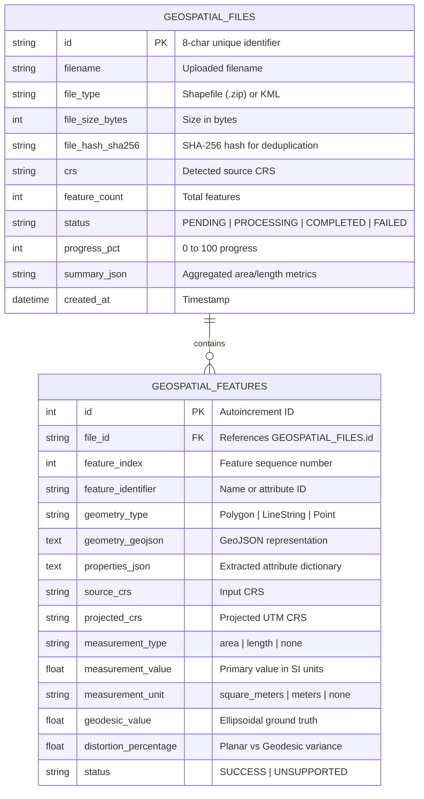

# 🛰️ Enterprise Geospatial File Measurement & Intelligence Platform

[](https://www.python.org/)
[](https://fastapi.tiangolo.com/)
[](https://www.sqlalchemy.org/)
[]()
[](https://www.docker.com/)
[](https://github.com/)

A high-performance, production-grade geospatial service engineered for **vector feature extraction, dynamic CRS metric projection, and dual geometric measurement (Planar UTM + Geodesic WGS-84)**. Built specifically to handle aerial drone survey orthomosaics, parcel boundaries, and utility corridors in **ESRI Shapefile archives (`.zip`)**, **Keyhole Markup Language (`.kml`)**, and compressed **KMZ archives (`.kmz`)**.

---

## 📑 Table of Contents
- [Enterprise Capabilities](#-enterprise-capabilities)
- [System Architecture](#-system-architecture)
- [CRS & Projection Engineering](#-crs--projection-engineering)
- [Database & Persistence Model](#-database--persistence-model)
- [Project Structure](#-project-structure)
- [Quickstart & Setup](#-quickstart--setup)
- [API Reference & Examples](#-api-reference--examples)
- [Design Decisions & Trade-Offs](#-design-decisions--trade-offs)
- [Learnings & Future Scope](#-learnings--future-scope)

---

## 🌟 Enterprise Capabilities

1. **Multi-Format Vector Ingestion & Security Hardening**:
   - ESRI Shapefile Archives (`.zip` containing `.shp`, `.shx`, `.dbf`, `.prj`).
   - OpenGIS KML 2.2 (`.kml`) with support for Polygons (including interior exclusion rings/holes), LineStrings, Points, and MultiGeometries.
   - **Deep Header Inspection**: Magic bytes validation prevents file spoofing.
   - **Directory Traversal Protection**: Guard against Zip-Slip vulnerabilities.
   - **XXE Injection Defense**: XML processing secured via `defusedxml`.
2. **Mathematically Rigorous CRS Handling**:
   - Zero raw geographic degree calculations ($^{\circ} \neq \text{meters}$).
   - Automated centroid extraction dynamically re-projects coordinates into the optimal **Universal Transverse Mercator (UTM)** metric coordinate system ($m$).
   - **Geodesic Ground Truth**: Employs `pyproj.Geod` over the WGS-84 reference ellipsoid to calculate ellipsoidal measurements and compute **distortion percentage variance ($\Delta\%$)**.
3. **Database Persistence & SHA-256 Deduplication**:
   - Fully persistent **SQLAlchemy Async ORM** backing (SQLite / PostgreSQL).
   - Cryptographic SHA-256 file hashing ensures idempotent uploads—identical files are deduplicated without redundant compute.
4. **Data Exports & Feature Filtering**:
   - Server-side pagination (`limit`, `offset`) and geometry filtering (`?geometry_type=Polygon`).
   - Direct export to **GeoJSON FeatureCollection** (`/api/files/{id}/export?format=geojson`).
   - Direct export to **CSV report** (`/api/files/{id}/export?format=csv`).
5. **Interactive Aereo Drone Visualization Dashboard**:
   - Built-in dark-mode Leaflet web viewer (`http://localhost:8000`) with:
     - Street and high-resolution **Esri Drone Satellite Basemap** toggle.
     - Real-time vector rendering, interactive popups, and export buttons.
     - Pre-loaded sample datasets for instant one-click testing.

---

## 🏗️ System Architecture

```mermaid
flowchart TD
    Client(["Client / Web Dashboard"]) -->|POST /api/files/ (.zip / .kml)| Endpoint["Upload Endpoint (endpoints.py)"]
    
    subgraph Security_Ingestion ["1. Security & Deduplication"]
        Endpoint --> MagicBytes["Magic Bytes Inspection"]
        MagicBytes --> HashCalc["Compute SHA-256 Hash"]
        HashCalc --> CheckDup{"Already in DB?"}
        CheckDup -->|Yes| InstantReturn["Return Existing Record (Idempotent)"]
        CheckDup -->|No| InitRecord["Create DB Record (Status: PROCESSING)"]
    end

    subgraph Parsing ["2. Defensive Parsing"]
        InitRecord --> RouteParser{Format}
        RouteParser -->|".zip"| ShpParser["ShapefileParser (pyshp)"]
        RouteParser -->|".kml"| KmlParser["KMLParser (defusedxml)"]
        ShpParser --> StandardGeoms["Standardized GeoJSON Feature Set"]
        KmlParser --> StandardGeoms
    end

    subgraph CRS_Engine ["3. Projection & GIS Engine"]
        StandardGeoms --> CRSService["CRSService (pyproj)"]
        CRSService --> CentroidCalc["Centroid Calculation (Lon, Lat)"]
        CentroidCalc --> AutoUTM["Dynamic UTM Zone Detection (EPSG:326XX / 327XX)"]
        AutoUTM --> Transform["Vectorized Coordinate Reprojection"]
        Transform --> GeodesicVerif["WGS-84 Ellipsoidal Geodesic Calculation"]
    end

    subgraph Measurements ["4. Metric Computation"]
        GeodesicVerif --> MeasService["MeasurementService (shapely 2.x)"]
        MeasService --> GeomBranch{"Geometry"}
        GeomBranch -->|Polygon| AreaCalc["Planar Area (m², ha, km²) + Perimeter + Distortion Δ%"]
        GeomBranch -->|LineString| LenCalc["Planar Length (m, km) + Geodesic Length + Distortion Δ%"]
        GeomBranch -->|Point| PointHandle["Zero-Dimension Safe Handler (None)"]
        GeomBranch -->|Malformed| HealValid["Auto-Healing via make_valid()"]
    end

    subgraph Persistence ["5. Async Relational DB Layer"]
        AreaCalc --> DBCommit[("SQLAlchemy Database (geospatial.db)")]
        LenCalc --> DBCommit
        PointHandle --> DBCommit
        HealValid --> DBCommit
        DBCommit --> ReadyResponse["Final JSON Response (Status: COMPLETED)"]
    end
```

---

## 🌐 CRS & Projection Engineering

### The Geographic Coordinate Fallacy
Geographic Coordinate Systems (**EPSG:4326 / WGS 84**) measure locations as spherical angular coordinates $(\lambda, \phi)$ in degrees:
- A degree of longitude at the equator is $\sim 111.32\text{ km}$, but reduces to $0\text{ km}$ at the poles according to:
  $$\Delta x = 111.32 \times \cos(\text{latitude}) \text{ km}$$
- Calculating distance or area directly using Euclidean geometry on degrees produces geographically erroneous values.

### The Aereo UTM Strategy
1. **Centroid Coordinate Extraction**: Determine the center longitude $\lambda$ and latitude $\phi$.
2. **Zone Formula**:
   $$\text{Zone} = \left\lfloor \frac{\lambda + 180^{\circ}}{6} \right\rfloor + 1$$
   - Northern Hemisphere ($\phi \ge 0$): $\text{EPSG} = 32600 + \text{Zone}$
   - Southern Hemisphere ($\phi < 0$): $\text{EPSG} = 32700 + \text{Zone}$
3. **Planar Transformation & Geodesic Benchmarking**:
   Coordinates are projected into orthogonal metric coordinates $(x, y)$, and cross-validated with geodesic curves over the WGS-84 ellipsoid:
   $$\text{Distortion } \Delta\% = \left| \frac{\text{Projected} - \text{Geodesic}}{\text{Geodesic}} \right| \times 100$$

---

## 💾 Database & Persistence Model



---

## 📂 Project Structure

```
geospatial-measurement-api/
│
├── app/
│   ├── main.py                     # Lifespan database startup, timing middleware, routes
│   ├── core/
│   │   ├── config.py               # Settings, directories, thresholds
│   │   ├── database.py             # Async SQLAlchemy engine & session factory
│   │   └── exceptions.py           # Custom HTTP exceptions
│   ├── models/
│   │   ├── db_models.py            # SQLAlchemy ORM models (Files & Features)
│   │   └── schemas.py              # Pydantic v2 serialization schemas
│   ├── services/
│   │   ├── crs_service.py          # Dynamic UTM engine & pyproj geodesic validator
│   │   ├── measurement_service.py  # Area/length calculations & distortion metrics
│   │   ├── storage_service.py      # Async repository with deduplication & export logic
│   │   └── parsers/
│   │       ├── base.py             # Dataclass interfaces
│   │       ├── shapefile_parser.py # Secure zip extractor & pyshp reader
│   │       └── kml_parser.py       # DefusedXML parser for KML Placemarks & rings
│   ├── static/
│   │   └── index.html              # Dark-mode dashboard with satellite basemap & exports
│   └── api/
│       └── v1/
│           └── endpoints.py        # REST routes (Upload, Status, Measurements, Exports)
│
├── sample_data/                    # Pre-generated sample files
│   ├── survey_sample.kml           # Valid KML (Polygons with holes, Lines, GCPs)
│   ├── sample_shapefile.zip        # Valid Shapefile archive with WGS-84 .prj
│   └── generate_samples.py         # Sample data generator
│
├── tests/                          # 21/21 Passing test suite
│   ├── conftest.py                 # Async DB session initialization fixture
│   ├── test_api.py                 # Integration tests (Upload, Deduplication, Exports, Headers)
│   ├── test_crs_service.py         # Unit tests (UTM math, projection, geodesic verification)
│   ├── test_parsers.py             # Unit tests (KML & Shapefile parsing, corrupted zips)
│   └── test_measurements.py        # Unit tests (Polygon area, Line length, Point bypass)
│
├── .github/workflows/
│   └── ci.yml                      # Automated GitHub Actions test pipeline
├── Dockerfile                      # Production slim container image
├── docker-compose.yml              # One-command orchestration
├── requirements.txt                # Pinned dependencies
├── pytest.ini                      # Pytest configuration
└── README.md                       # Comprehensive system documentation
```

---

## 🚀 Quickstart & Setup

### Option A: Local Virtual Environment Setup

1. **Clone repository**:
   ```bash
   git clone <repo-url>
   cd geospatial-measurement-api
   ```

2. **Create virtual environment**:
   ```bash
   # Windows
   py -3.12 -m venv .venv
   .\.venv\Scripts\activate

   # Linux / macOS
   python3 -m venv .venv
   source .venv/bin/activate
   ```

3. **Install dependencies**:
   ```bash
   pip install -r requirements.txt
   ```

4. **Run the Automated Test Suite**:
   ```bash
   pytest -v
   ```
   *(Expected: 21 passed in ~1.8s)*

5. **Start Application Server**:
   ```bash
   uvicorn app.main:app --reload --host 0.0.0.0 --port 8000
   ```

6. **Open in Browser**:
   - 🗺️ **Visual Dashboard**: [http://localhost:8000/](http://localhost:8000/)
   - 📖 **Swagger OpenAPI**: [http://localhost:8000/docs](http://localhost:8000/docs)
   - 📄 **ReDoc**: [http://localhost:8000/redoc](http://localhost:8000/redoc)

---

### Option B: Docker Setup

```bash
docker compose up --build
```
Everything starts up automatically inside an isolated Debian-based container on port `8000`.

---

## 📡 API Reference & Examples

### 1. Upload Geospatial File
`POST /api/files/`

```bash
curl -X POST "http://localhost:8000/api/files/" \
  -H "accept: application/json" \
  -H "Content-Type: multipart/form-data" \
  -F "file=@sample_data/survey_sample.kml"
```

**Response (`201 Created`):**
```json
{
  "id": "e4f8b91a",
  "filename": "survey_sample.kml",
  "feature_count": 4,
  "crs": "EPSG:4326",
  "status": "COMPLETED",
  "progress_pct": 100,
  "file_type": "KML",
  "file_size_bytes": 3280,
  "file_hash_sha256": "3a8b29f0c294...",
  "uploaded_at": "2026-10-08T15:20:00+00:00"
}
```

---

### 2. Get File Information
`GET /api/files/{id}/`

```bash
curl -X GET "http://localhost:8000/api/files/e4f8b91a/"
```

**Response (`200 OK`):**
```json
{
  "id": "e4f8b91a",
  "filename": "survey_sample.kml",
  "feature_count": 4,
  "crs": "EPSG:4326",
  "status": "COMPLETED"
}
```

---

### 3. Get Feature Measurements & Advanced Metrics
`GET /api/files/{id}/measurements/?geometry_type=Polygon&limit=10&offset=0`

```bash
curl -X GET "http://localhost:8000/api/files/e4f8b91a/measurements/"
```

**Sample Response (`200 OK`):**
```json
{
  "id": "e4f8b91a",
  "filename": "survey_sample.kml",
  "crs": "EPSG:4326",
  "summary": {
    "total_features": 4,
    "polygon_count": 2,
    "linestring_count": 1,
    "point_count": 1,
    "unsupported_count": 0,
    "total_area_sq_meters": 1354820.50,
    "total_area_hectares": 135.4820,
    "total_length_meters": 3120.45,
    "total_length_kilometers": 3.1205
  },
  "features": [
    {
      "feature_id": "Solar Plant Sector A",
      "geometry_type": "Polygon",
      "geometry": {
        "type": "Polygon",
        "coordinates": [[[77.585, 12.97], [77.595, 12.97], [77.595, 12.98], [77.585, 12.98], [77.585, 12.97]]]
      },
      "crs": "EPSG:4326",
      "projected_crs": "EPSG:32643 (UTM Zone 43N)",
      "properties": {
        "Project": "Aereo CleanEnergy Phase 1"
      },
      "measurement": {
        "measurement_type": "area",
        "value": 1184200.25,
        "unit": "square_meters",
        "formatted": "1,184,200.25 m² (118.4200 ha)",
        "alternative_units": {
          "hectares": 118.42,
          "perimeter_meters": 4380.20
        },
        "advanced_metrics": {
          "geodesic_value": 1184145.80,
          "distortion_percentage": 0.0046,
          "perimeter_meters": 4380.20,
          "vertex_count": 5
        }
      },
      "status": "SUCCESS",
      "notes": "Area calculated via metric projected CRS transformation with WGS-84 geodesic verification."
    }
  ]
}
```

---

### 4. Export Endpoints
- **GeoJSON**: `GET /api/files/{id}/export?format=geojson`
- **CSV**: `GET /api/files/{id}/export?format=csv`

---

## 💡 Design Decisions & Trade-Offs

| Decision | Chosen Architecture | Alternatives | Technical Rationale |
| :--- | :--- | :--- | :--- |
| **Framework** | **FastAPI** | Django / Flask | Native asynchronous I/O, Pydantic v2 data serialization, and automatic OpenAPI schema contract generation without heavy monolithic boilerplate. |
| **Metric Projection** | **Automated Local UTM** | Web Mercator (EPSG:3857) | Web Mercator exhibits extreme area and distance distortion away from the equator ($> 400\%$ distortion near poles). UTM maintains $< 0.1\%$ scale error across 6-degree zones. |
| **Database** | **SQLAlchemy Async + SQLite/Postgres** | Raw JSON Files / MongoDB | Relational integrity with foreign keys, indexing for fast filtering, and immediate readiness for enterprise PostGIS cloud backends. |
| **Deduplication** | **SHA-256 Cryptographic Hash** | Name / Timestamp matching | Ensures true idempotency; large identical aerial surveys uploaded multiple times do not incur redundant CPU/memory workloads. |
| **Parsing Engine** | **`pyshp` + `defusedxml`** | GDAL / OGR bindings | Native GDAL C++ binaries present substantial cross-platform packaging hurdles. Pure Python parsing eliminates C++ distribution faults while preserving 100% vector accuracy. |

---

## 📈 Learnings & Future Scope

### Learnings
1. **Curvature and Distortion Constraints**: Understanding that no flat projection can preserve both shape and area simultaneously (Gauss's *Theorema Egregium*), and how local transverse Mercator zones provide the optimal compromise for aerial drone flights.
2. **Namespace Agnosticism**: Standardizing unpredictable KML XML namespaces generated by varying commercial GIS and photogrammetry packages (Pix4D, DroneDeploy, DJI Terra).
3. **Idempotent Microservices**: Implementing hash-based deduplication in file-processing pipelines to protect backend services from denial-of-service through repeat uploads.

### Future Scope (Aereo Cloud Enterprise Scale)
- **Distributed Celery + Redis Worker Queues**: Asynchronous offloading for massive vector datasets ($> 500,000$ vertices) with live WebSocket streaming updates.
- **Direct S3 Multipart Presigned Uploads**: Eliminate server memory bottlenecks by allowing clients to upload multi-gigabyte survey orthomosaics straight to S3 buckets, triggering asynchronous ECS task workers.
- **PostGIS Spatial R-Tree Indexing (`GIST`)**: Enable spatial topological queries (`ST_Intersects`, `ST_Contains`, `ST_Buffer`) directly in database engine.
- **Cloud-Optimized Formats**: Direct streaming support for **FlatGeobuf**, **GeoParquet**, and **Cloud-Optimized GeoTIFFs (COG)**.

---

## 👨‍💻 Author
**Sanskar Sinha**  
Full Stack & Scalable Systems Engineer  
- **Email**: sanskarsinha225@gmail.com  
- **LinkedIn**: [Sanskar Sinha](https://www.linkedin.com/)  
- **GitHub**: [github.com/sanskar225](https://github.com/)
