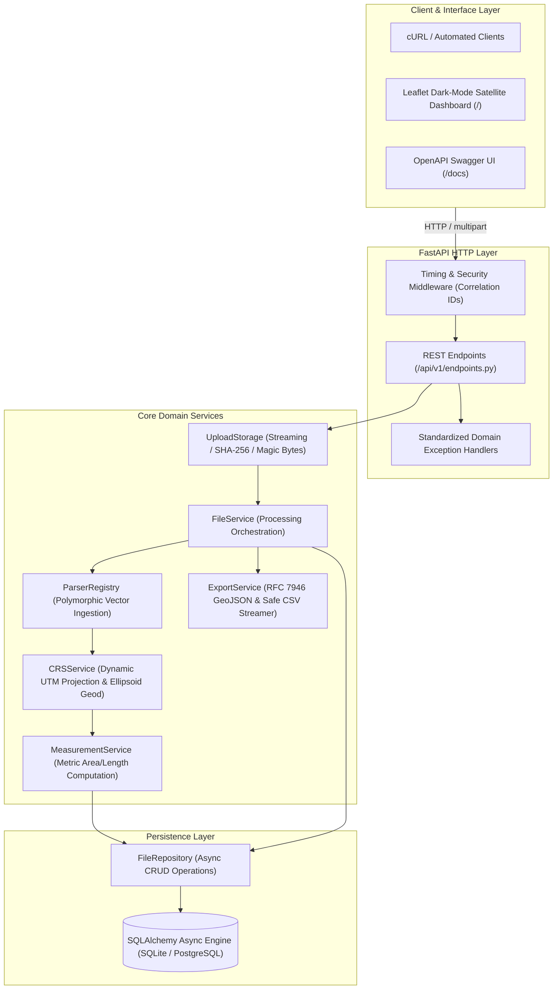

# 🏛️ System Architecture & Engineering Trade-offs

## Project: Geospatial File Measurement & Intelligence API
**Target Platform:** Aereo Cloud  
**Author:** Sanskar Sinha  

---

## 1. Architectural Philosophy

The service is designed around three architectural pillars:
1. **Mathematical Integrity**: Coordinate reference systems are treated with strict mathematical rigor. Angular degrees are never directly calculated.
2. **Defensive Processing**: Vector data in the wild is messy. Parsing and processing isolate feature-level corruption so valid survey data is never discarded.
3. **Zero Native Dependency Overhead**: Traditional GIS stacks rely on heavy system binaries (GDAL, GEOS, PROJ). This platform utilizes self-contained, pre-compiled wheels (`shapely 2.x`, `pyproj`, `pyshp`, `defusedxml`), enabling instant containerization and lightweight deployment.

---

## 2. Layered Architecture Diagram

---

## 3. Engineering Decisions & Evaluated Trade-offs

### 3.1 Framework Selection: FastAPI vs. Django + DRF
- **Decision**: **FastAPI**
- **Rationale**: The assignment focuses on high-performance vector file ingestion, streaming serialization, and mathematical computing. FastAPI provides native asynchronous request processing, automatic OpenAPI/ReDoc generation, and zero unnecessary overhead (no monolithic ORM migrations, admin sites, or session tables).
- **Trade-off**: For multi-tenant user authentication and complex RBAC in future phases, Django provides out-of-the-box admin tooling; however, FastAPI's modular dependency injection (`app/api/deps.py`) allows clean integration with OAuth2 / OIDC providers.

### 3.2 Dynamic Local Projection vs. Single Global Projection
- **Decision**: **Dynamic Local UTM Projection per feature**
- **Rationale**: Aerial surveys occur globally (e.g., Aereo's mining operations in India, UAE, and Australia). Projecting to a single global system like Web Mercator (`EPSG:3857`) introduces extreme areal distortions away from the equator (up to 800% at high latitudes). Local UTM zones keep planar linear distortion within $\approx 0.1\%$.
- **Geodesic Validation**: Every planar metric is cross-checked against ellipsoidal geodesic calculations (`pyproj.Geod`) over WGS-84, surfacing any distortion variance ($\Delta\%$) directly to the surveyor.

### 3.3 In-Memory Streaming vs. Disk-Expanded Parsing
- **Decision**: **In-memory archive extraction with streaming size validation**
- **Rationale**: Writing uploaded archives to temporary disk directories creates file-descriptor leaks, disk exhaustion risks, and vulnerabilities to Zip-Slip path traversal attacks. In-memory processing eliminates disk I/O latency and security risks while enforcing strict expansion thresholds ($50\text{ MB}$ raw upload, $250\text{ MB}$ expanded cap).

### 3.4 Feature-Level Fault Isolation vs. Strict All-or-Nothing Ingestion
- **Decision**: **Per-feature status tracking with auto-healing**
- **Rationale**: A real-world drone survey may contain 5,000 parcel boundaries where a single polygon has a self-intersecting bowtie or missing coordinate. Rejecting the entire file wastes surveyor field time. The service repairs geometries via `shapely.make_valid()`. If irreparably malformed, the specific feature is flagged with `INVALID_GEOMETRY`, while all valid features are calculated and stored.

---

## 4. Concurrency & Scaling Considerations

1. **Async I/O**: File uploads, streaming responses, and database interactions use Python's `asyncio` event loop.
2. **CPU-Bound Computation**: For massive vector files exceeding 10,000 features, computation is decoupled into asynchronous worker tasks (`?background=true`), returning HTTP 202 with polling telemetry.
3. **PostGIS Readiness**: Database models utilize JSON representations for geometries with standard SQL columns for metric values, enabling a zero-downtime migration to PostgreSQL / PostGIS geometry columns in production.
