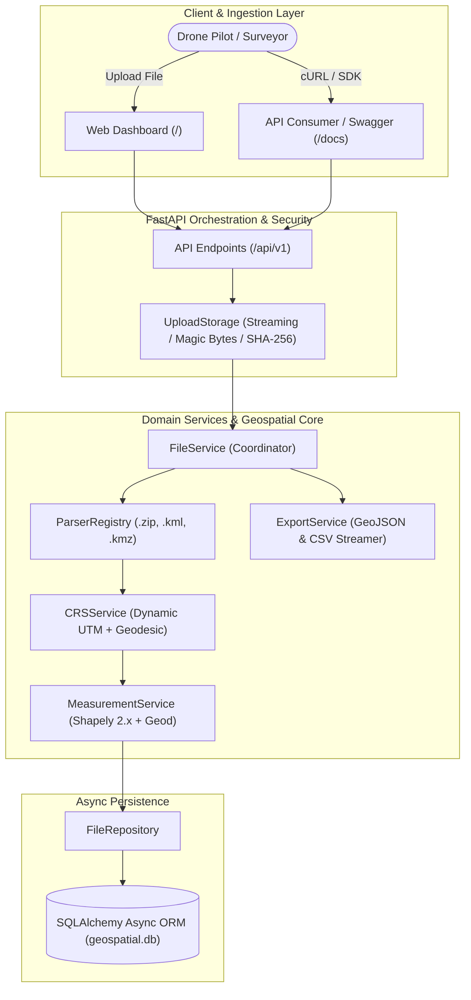

# 🚀 Minimum Viable Product (MVP) Specification & Architecture

## Project: Geospatial File Measurement & Intelligence API
**Target Platform:** Aereo Cloud  
**Author:** Sanskar Sinha  
**Version:** 2.0.0  

---

## 1. Product Vision & MVP Definition

The MVP solves a fundamental bottleneck in aerial survey processing: **transforming raw, disparate drone CAD/GIS vector uploads into verified, metric survey intelligence without spatial distortion or infrastructure bloat.**

In enterprise drone intelligence platforms (such as Aereo Cloud), field surveys and mine site boundary models arrive in varied formats and unprojected coordinates. Standard GIS toolchains often crash on corrupt vertices or silently compute erroneous areas in squared degrees ($(\text{deg})^2$).

This MVP establishes a bulletproof, production-grade microservice that guarantees:
1. **Mathematical Accuracy**: Dynamic local UTM metric reprojection with WGS-84 ellipsoidal cross-checking.
2. **Defensive Processing**: Fault-tolerant feature extraction where malformed geometry is isolated or auto-repaired.
3. **Zero-Friction Ingestion**: Self-contained Python runtime without brittle system GDAL installations.
4. **Immediate Usability**: Interactive drone satellite visualization dashboard for instant field verification.

---

## 2. Core MVP Feature Matrix

| Feature Module | Requirement Status | Production Solution |
| :--- | :--- | :--- |
| **Multi-Format Vector Ingestion** | **Core Requirement** | Supports ESRI Shapefile (`.zip`), OpenGIS KML 2.2 (`.kml`), and KMZ archives (`.kmz`). |
| **CRS & Metric Projection** | **Core Requirement** | Dynamic centroid-to-UTM / UPS reprojection. No raw geographic degree calculations. |
| **Geometric Measurements** | **Core Requirement** | Planar Area ($m^2, ha, km^2$) + Perimeter for Polygons; Planar Length ($m, km$) for LineStrings; Points handled gracefully. |
| **Geodesic Ground Truth** | **Enterprise Value-Add** | `pyproj.Geod` calculates ellipsoidal metrics and reports distortion percentage ($\Delta\%$). |
| **Fault Isolation & Auto-Repair** | **Enterprise Value-Add** | Per-feature status tracking; `shapely.make_valid()` heals self-intersections. |
| **SHA-256 Deduplication** | **Enterprise Value-Add** | Single-pass streaming hash check provides idempotent uploads and saves compute. |
| **Streaming Exports** | **Enterprise Value-Add** | RFC 7946 GeoJSON and CSV download with formula injection mitigation. |
| **Async Relational Persistence** | **Enterprise Value-Add** | SQLAlchemy Async ORM with portable types (SQLite / PostgreSQL ready). |
| **Interactive Satellite Dashboard** | **Enterprise Value-Add** | Built-in Leaflet UI at `/` with high-resolution Esri Drone Satellite basemap. |

---

## 3. High-Level MVP Architecture



---

## 4. MVP Data Contracts & Schemas

### 4.1 Ingestion Request
- **Endpoint**: `POST /api/files/`
- **Content-Type**: `multipart/form-data`
- **Parameters**: `file` (Binary), `background` (Optional boolean for async jobs)

### 4.2 Ingestion Response (`201 Created` / `200 OK` Deduplicated)
```json
{
  "id": "5c1e0a77b8f94d0e9d3a4b2f6a8c1d20",
  "filename": "mine_boundary.kml",
  "feature_count": 4,
  "crs": "EPSG:4326",
  "status": "COMPLETED",
  "progress_pct": 100,
  "file_type": "KML",
  "file_size_bytes": 2734,
  "file_hash_sha256": "e94bf49d...",
  "error_message": null,
  "warnings": [],
  "uploaded_at": "2026-10-08T21:18:02.158849Z"
}
```

### 4.3 Feature Measurement Payload (`GET /api/files/{id}/measurements/`)
```json
{
  "file_id": "5c1e0a77b8f94d0e9d3a4b2f6a8c1d20",
  "filename": "mine_boundary.kml",
  "feature_count": 4,
  "crs": "EPSG:4326",
  "status": "COMPLETED",
  "summary": {
    "total_polygon_area_sq_m": 128450.50,
    "total_polygon_area_hectares": 12.845,
    "total_polygon_area_sq_km": 0.128,
    "total_linestring_length_m": 1840.20,
    "total_linestring_length_km": 1.84
  },
  "features": [
    {
      "feature_id": "pit_sector_a",
      "geometry_type": "Polygon",
      "status": "SUCCESS",
      "source_crs": "EPSG:4326",
      "projected_crs": "EPSG:32643",
      "measurement": {
        "measurement_type": "area",
        "value": 128450.50,
        "unit": "sq_meters",
        "formatted": "128,450.50 sq m (12.85 ha)",
        "advanced_metrics": {
          "perimeter_meters": 1420.15,
          "geodesic_value": 128380.20,
          "distortion_percentage": 0.05
        }
      }
    }
  ]
}
```

---

## 5. Security & Defense In Depth

1. **Hostile Payload Protection**:
   - Files read strictly in memory; zero file system directory expansion eliminates Zip-Slip risks.
   - Max 50 MB upload cap, 250 MB uncompressed limit, and 500 entry limit prevent zip-bomb denial of service.
   - `defusedxml` mitigates XML entity expansion (Billion Laughs) and remote DTD resolution.
2. **Spreadsheet Security**:
   - CSV export automatically sanitizes attributes beginning with `=`, `+`, `-`, or `@` to neutralize formula injection in Microsoft Excel and LibreOffice.
3. **Data Integrity**:
   - SHA-256 cryptographic hashes guarantee upload idempotency and prevent duplicate compute workloads.

---

## 6. MVP vs. Post-MVP Roadmap (Aligned with Aereo Cloud)

| Capability | MVP (Current Release) | Phase 2 (Aereo Cloud Integration) |
| :--- | :--- | :--- |
| **Vector Geometry** | 2D Polygons, LineStrings, Points | 3D slope measurements, elevation profiles |
| **Raster Data** | None | GeoTIFF / MBTiles stockpile & cut-fill volume estimation |
| **Surveys Over Time** | Single survey measurement | Temporal plan-vs-actual change comparison (`/compare`) |
| **Background Processing** | In-process asyncio tasks | Distributed Redis + Celery workers with SSE progress events |
| **Spatial Database** | SQLite / PostgreSQL JSON | PostGIS spatial indexing & vector tile serving |
| **Authentication** | Request-id & open CORS | JWT / OIDC multi-tenant organization isolation |
